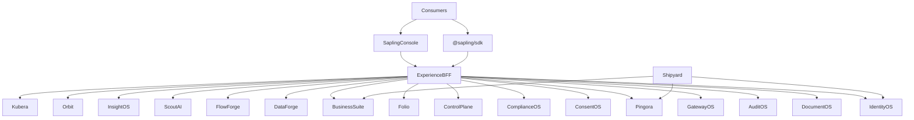

# Unify Sapling Cloud (docs stay with products; official names)

Tagline: **Plant an idea. Build anything.** Use **Sapling** consistently in architecture, PRDs, HLDs, LLDs, SDKs, and implementation.

## Decisions that stay

- One umbrella monorepo; **no code or docs deleted**.
- **Sapling Console** is the experience shell (iframe/proxy onto existing product UIs). Platform-admin is a **role/mode** in the same Console, not a second product.
- Runnable PaaS repos are systems of record; `@platform/*` libraries are adapters.
- Cloud owns identity, billing engines, queues, notifications, search, analytics; Business Suite owns business rules and data.
- **Each named OS is a first-class product**, same standing as Orbit and Kubera. **Sapling Core and Sapling Governance are import snapshots only**, not products in the catalog.

## Official product names

**From the naming convention (authoritative):**

- Unified platform: **Sapling**
- Developer portal: **Sapling Console**
- Unified SDK: **`@sapling/sdk`**
- Identity and access: **Sapling IdentityOS**
- Product intelligence: **Sapling InsightOS** (this is [pi-platform](g:\sapling\Product_Intelligence_TypeScript_Monorepo\pi-platform), not the suite BI module)
- Billing and entitlements: **Sapling Kubera**
- Database PaaS: **Sapling DataForge**
- Notifications: **Sapling Pingora**
- Workflow execution: **Sapling FlowForge**
- CI/CD: **Sapling Shipyard**
- Mobile delivery: **Sapling Orbit**
- AI search: **Sapling ScoutAI**

**First-class OS products (do not nest under sapling-core or sapling-governance):**

Today they happen to live in two bundles. Target layout treats each like Orbit:

- **Sapling IdentityOS** — from [sapling-core `apps/api/src/identity.ts`](g:\sapling\sapling-cloud-core-services\sapling-core\apps\api\src\identity.ts)
- **Sapling DocumentOS** — from [documents.ts](g:\sapling\sapling-cloud-core-services\sapling-core\apps\api\src\documents.ts)
- **Sapling AuditOS** — from [audit.ts](g:\sapling\sapling-cloud-core-services\sapling-core\apps\api\src\audit.ts)
- **Sapling GatewayOS** — from [gateway.ts](g:\sapling\sapling-cloud-core-services\sapling-core\apps\api\src\gateway.ts) (API keys and route config). Distinct from the new Console **BFF** in `apps/gateway`.
- **Sapling ConsentOS** — from [apps/consent-api](g:\sapling\sapling-governance\sapling-governance\apps\consent-api)
- **Sapling ComplianceOS** — from [apps/compliance-api](g:\sapling\sapling-governance\sapling-governance\apps\compliance-api)

**Named now (no official name existed):**

- Headless CMS ([sapling-cms](g:\sapling\sapling-cms\sapling-cms)): **Sapling Folio**
- 12-domain IaaS catalog ([sapling-internal-cloud](g:\sapling\sapling-internal-cloud\sapling-cloud)): **Sapling Control Plane**
- Validation lib ([foundation-validation](g:\sapling\foundation-validation\foundation-validation)): **`@sapling/validation`**
- React toolkit ([react-toolkit-mvp](g:\sapling\react-toolkit-mvp\react-toolkit)): **`@sapling/react-toolkit`**
- Utility toolkit ([es-toolkit-expanded](g:\sapling\es-toolkit-expanded)): **`@sapling/toolkit`**
- Cross-cutting libs: **Sapling Platform Libraries** (`@platform/*` A–R stay named as-is until a later rename)
- Helm + pipeline templates: **Shipyard** (canonical chart from [kubernetes-helm-starter-kit](g:\sapling\kubernetes-helm-starter-kit\kubernetes-helm-starter-kit); keep [app-service-0.1.0](g:\sapling\app-service-0.1.0) as history)

Business Suite areas in [ARCHITECTURE.md](g:\sapling\sapling-business-suite-unified-ui\sapling-business-suite\docs\ARCHITECTURE.md) stay suite modules (ReachOS, DealOS, RevenueOS, CareOS, PeopleOS, FinanceOS, GovernanceOS, ProductOS, OperationsOS). Suite **GovernanceOS** is legal/business process, not ConsentOS/ComplianceOS. Suite analytics stays **BusinessIntelligence** and consumes **InsightOS**.

Phase 0 does **not** rewrite every `package.json` inside `imported/`. New product folders and Console/SDK use official names. `docs/architecture/NAMING.md` maps old folders to products.

## All 20 trees to import (verbatim snapshots)

Copy into `imported/` with original folder names. Bundles that contain multiple products stay as **source snapshots**; products are promoted next to them.

- `imported/sapling-core/` — snapshot only (today one Express API with four modules + shared `docs/`)
- `imported/sapling-governance/` — snapshot only (today consent-api + compliance-api + one console)
- `imported/sapling-cloud/` → Control Plane
- `imported/sapling-business-suite/` → Business Suite
- `imported/sapling-cms/` → Folio
- `imported/dbaas-platform/` → DataForge
- `imported/notification-paas/` → Pingora
- `imported/internal-workflow-paas/` → FlowForge
- `imported/atlas-web-intelligence-platform/` → ScoutAI
- `imported/pi-platform/` → InsightOS
- `imported/mobile-delivery-paas/` → Orbit
- `imported/kubera-monorepo/` → Kubera
- `imported/saas-paas-capabilities-monorepo/` → Platform Libraries
- `imported/foundation-validation/` → `@sapling/validation`
- `imported/react-toolkit/` → `@sapling/react-toolkit`
- `imported/es-toolkit-expanded/` → `@sapling/toolkit`
- `imported/kubernetes-helm-starter-kit/` → Shipyard chart
- `imported/app-service-0.1.0/` → Shipyard historical chart
- `imported/cpg_kubera_documentation_bundle/` → Kubera PDF specs
- `imported/Cross_Cutting_Capabilities_A_to_R_PDFs/` → Platform Libraries PDF specs

## Promote bundled OS into `products/` (copy, do not delete)

After import, copy modules into sibling product trees so teams work the same way they would on Orbit or Kubera. Original bundles remain in `imported/` so nothing is lost.

```
products/
  identityos/          # IdentityOS API + its docs + SDK slice
  documentos/          # DocumentOS API + docs + SDK slice
  auditos/             # AuditOS API + docs + SDK slice
  gatewayos/           # GatewayOS API + docs + SDK slice
  consentos/           # ConsentOS API + docs + SDK (from apps/consent-api)
  complianceos/        # ComplianceOS API + docs + SDK (from apps/compliance-api)
```

How the copy maps from current code:

- sapling-core is a modular monolith: [identity.ts](g:\sapling\sapling-cloud-core-services\sapling-core\apps\api\src\identity.ts), [documents.ts](g:\sapling\sapling-cloud-core-services\sapling-core\apps\api\src\documents.ts), [audit.ts](g:\sapling\sapling-cloud-core-services\sapling-core\apps\api\src\audit.ts), [gateway.ts](g:\sapling\sapling-cloud-core-services\sapling-core\apps\api\src\gateway.ts), shared [schema.ts](g:\sapling\sapling-cloud-core-services\sapling-core\apps\api\src\schema.ts) / [common.ts](g:\sapling\sapling-cloud-core-services\sapling-core\apps\api\src\common.ts). Each product gets its own `apps/api`, schema slice, and `docs/` (copy relevant HLD/LLD/PRD sections; leave the combined files in `imported/sapling-core/docs/`).
- sapling-governance already has two deployables ([consent-api](g:\sapling\sapling-governance\sapling-governance\apps\consent-api), [compliance-api](g:\sapling\sapling-governance\sapling-governance\apps\compliance-api)). Split the unified console later; until then Console can mount the existing UI at `/consentos` and `/complianceos` with different default routes. Copy each API + SDK + its docs into `products/`. Keep `imported/sapling-governance/` intact.

Shared Postgres in the snapshot is an implementation accident, not a product boundary (core HLD already says that).

## Docs policy: stay with the product

Do **not** flatten ~271 `docs/` files plus READMEs/PDFs into one site.

- Snapshot docs stay under `imported/<tree>/docs/`.
- Promoted OS products each get a `docs/` folder (copied/split from the bundle) so a team opening `products/identityos/` sees IdentityOS PRD/HLD/LLD without reading sapling-core.
- Foundation-validation and es-toolkit docs at package root stay there.
- Umbrella `docs/` is an **index only**: OWNERSHIP.md, NAMING.md, IMPORT_MANIFEST.md, catalog.md (one row per product, not per old repo).
- Conflicting docs both stay; OWNERSHIP.md is runtime truth.

## Target layout

```
sapling/
  imported/                      # all 20 trees unchanged, including sapling-core and sapling-governance snapshots
  products/                      # first-class OS products (split copies)
    identityos/
    documentos/
    auditos/
    gatewayos/
    consentos/
    complianceos/
  apps/
    console/                     # Sapling Console
    gateway/                     # experience-layer BFF (not GatewayOS)
  packages/
    contracts/                   # @sapling/cloud-contracts
    sdk/                         # @sapling/sdk re-exports
    ui-shell/
    validation/
    react-toolkit/
    toolkit/
    platform/
  infra/
    shipyard/
    compose/
  docs/
    architecture/
    catalog.md
```

**Workspace collisions (rename `name` fields only, keep source):**

- Cloud `@sapling/api` → `@sapling/control-plane-api`
- Suite `@sapling/api` → `@sapling/business-api`
- Cloud `@sapling/console` → `@sapling/control-plane-console`
- Governance `@sapling/console` → `@sapling/governance-console` (snapshot only; products get `@sapling/consentos-*` and `@sapling/complianceos-*`)
- New umbrella SDK is `@sapling/sdk`; existing product SDKs stay and are re-exported
- New contracts package is `@sapling/cloud-contracts` (no clash with snapshot `@sapling/contracts`)



## Stitch (additive)

1. **Sapling Console** — IdentityOS login, tenant switcher, catalog of **products** (not bundles). Mounts: `/identityos`, `/documentos`, `/auditos`, `/gatewayos`, `/consentos`, `/complianceos`, `/control-plane`, `/suite`, `/pingora`, `/flowforge`, `/orbit`, `/dataforge`, `/scout`, `/insight`, `/kubera`, `/folio`.
2. **Experience BFF** (`apps/gateway`) — verify IdentityOS; route `/v1/identity`, `/v1/documents`, `/v1/audit`, `/v1/gatewayos`, `/v1/consent`, `/v1/compliance`, plus Pingora, FlowForge, Kubera, suite, Orbit, DataForge, ScoutAI, InsightOS, Folio.
3. **Control Plane catalog** — one entry per product above; IaaS A–L stay stubs. No catalog card named “Sapling Core” or “Sapling Governance”.
4. **`@sapling/sdk`** — re-exports IdentityOS, DocumentOS, AuditOS, GatewayOS, ConsentOS, ComplianceOS, Orbit, Kubera, and other product SDKs.
5. **Shipyard** — Helm per product; compose boots Postgres, Redis, MinIO, IdentityOS, BFF, Console, Pingora, FlowForge, Orbit first.

## Phases (no deletions)

### Phase 0 — House, name, and split OS products

- Init repo, pnpm + turbo, copy all 20 trees into `imported/`.
- Copy sapling-core modules into `products/identityos`, `products/documentos`, `products/auditos`, `products/gatewayos`.
- Copy sapling-governance APIs into `products/consentos`, `products/complianceos`.
- Collision-safe npm names; NAMING.md, OWNERSHIP.md, IMPORT_MANIFEST.md, catalog.md.

### Phase 1 — Sapling Console + IdentityOS

- `apps/console` + `packages/ui-shell`.
- Login against **IdentityOS** as its own product.
- Mount Control Plane, Business Suite, Pingora, FlowForge first; add each OS product and Orbit as proxy paths exist.

### Phase 2 — BFF and `@sapling/sdk`

- Routes for IdentityOS, DocumentOS, AuditOS, GatewayOS, ConsentOS, ComplianceOS, Pingora, FlowForge, Kubera, suite, then Orbit and remaining PaaS.
- `packages/cloud-contracts` + `@sapling/sdk`.
- `infra/compose` for the stitched subset.

### Phase 3 — Catalog + Shipyard

- Register every named product in Control Plane (no Core/Governance bundle cards).
- Helm values per product; pipeline templates under `infra/shipyard`.

### Phase 4 — Consume (later)

- RevenueOS → Kubera; CareOS → Pingora; Folio approvals → FlowForge; BusinessIntelligence → InsightOS; Folio files → DocumentOS; all products → IdentityOS + AuditOS.
- Only then consider retiring the `imported/sapling-core` and `imported/sapling-governance` snapshots. Still no silent deletes.

## Success

One clone, one **Sapling Console** login, one catalog of **separate** products: IdentityOS, DocumentOS, AuditOS, GatewayOS, ConsentOS, ComplianceOS, Orbit, ScoutAI, DataForge, Pingora, FlowForge, InsightOS, Kubera, Folio, Shipyard, Control Plane, Business Suite. Every original tree and **its docs** remain under `imported/`.
