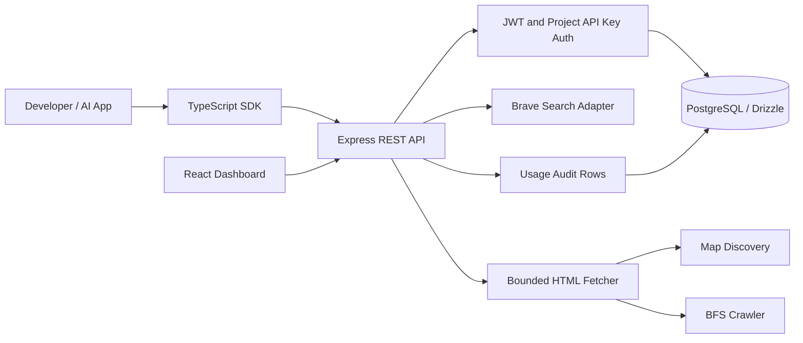

# High-Level Design

## Tenancy
Each user owns projects; each key belongs to exactly one project; API requests resolve the project from a SHA-256 key digest. Ownership is checked for dashboard project operations. Organization/team RBAC is a future enhancement.

## Trust boundaries
Browser JWT for console operations, API key for machine-to-machine calls. Outbound web fetches are untrusted and require isolated network egress in production. Database is private infrastructure. Never expose search provider credentials to SDK consumers.

## Deployment recommendation
TLS reverse proxy + WAF + stateless API replicas + managed PostgreSQL + dedicated isolated crawler workers + queue + Redis quota store + centralized telemetry. Current MVP is synchronous and single API process.
