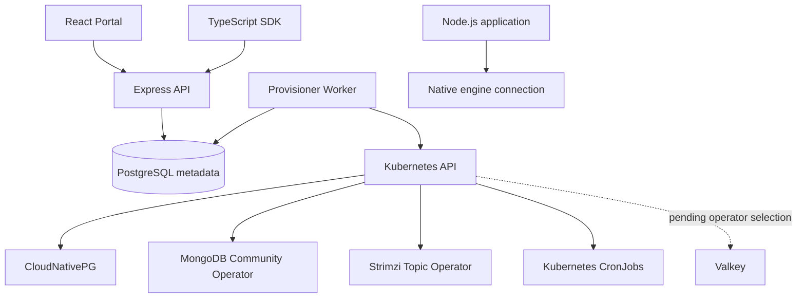

# High-level and low-level architecture

## Product boundary

This is an internal control plane for five offerings: PostgreSQL (SQL), MongoDB (NoSQL), Valkey (KV), Kafka (streams/topics), and distributed scheduled jobs (Kubernetes CronJob). Multi-team self-service and scoped tenancy are target requirements; current code is a functional foundation, **not** full multi-tenant authorization.

## Architecture

Control plane: inventory, desired configuration, audit, provisioning operations and team/service registry. Data plane: database and broker traffic, directly from application to native engine endpoints. Kubernetes manifests are managed by selected operators, not a generic Deployment for every database.

## Data model

- `teams (id, name, slug)`
- `services (id, team_id, name, environment, repository)`
- `resources (id, service_id, name, engine, plan, status, config, observed, last_error)`
- `operations (id, resource_id, type, status, attempts, idempotency_key, request_hash, next_run_at)`
- `jobs (id, service_id, name, schedule, time_zone, image, command, concurrency_policy, status)`
- `audit_events (id, actor, action, target, details, created_at)`

## API processing

1. Authenticate request (currently dev token only).
2. Validate JSON using Zod, enforce role (currently simulated admin).
3. Persist resource and operation in transaction with key-level advisory lock for idempotency.
4. Return HTTP 202 and operation ID.
5. Worker claims queued operations using `FOR UPDATE SKIP LOCKED` and sets running.
6. Worker simulates or creates Kubernetes custom resources; records error and exponential retry.
7. Return status from `/v1/operations/:id`.

Kubernetes submission is **not** database readiness. The full controller needs to reconcile `.status.conditions`, verify networking/credentials, and only mark ready after all stages succeed.

## API map

| Verb | Route | Notes |
|---|---|---|
| GET/POST | `/v1/teams` | list and register |
| GET/POST | `/v1/services` | list and register |
| GET/POST | `/v1/resources` | list and asynchronous provision |
| GET | `/v1/resources/:id` | resource state |
| DELETE | `/v1/resources/:id` | admin delete operation |
| GET | `/v1/operations/:id` | operation status |
| GET/POST | `/v1/jobs` | scheduled job inventory/request |
| GET | `/v1/usage/summary` | inventory counters (not metering) |
| GET | `/v1/audit` | audit records (admin) |
| GET | `/health/live`, `/health/ready` | liveness and DB readiness |

## Provisioning concerns

- Operators installed independently: CloudNativePG, Strimzi, MongoDB Community. Valkey operator must be chosen and implemented.
- Network policy, principal provisioning, credentials, backups, recovery and TLS must be configured on the actual data plane.
- Operator-specific API/CRD versions and upgrade policy need pinning and compatibility tests.
- Soft deletion, retention, restore, namespace placement, tiers, quotas, workload identity and tenants need further implementation.
- Avoid claiming exactly-once scheduled execution. Jobs must use idempotency keys where business correctness requires it.

## Tenancy target

Identity -> organization/team membership -> service/environment -> resource -> allowed action. All list and CRUD SQL queries must enforce server-side membership filters. Namespace and physical-cluster isolation should match sensitivity/tier; namespaces alone are not strong isolation boundaries.
