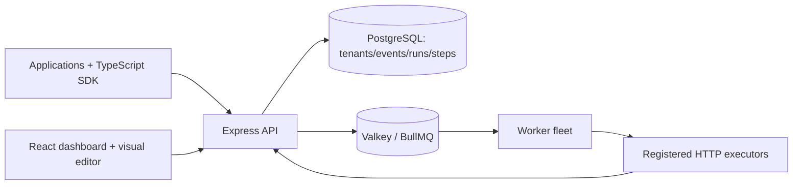

# High-level design

## Control plane
Tenant provisioning, projects, hashed API keys, definitions, run inspection, replay, audit, workflow graph persistence.

## Data plane
Event POST persists event and matching run rows, enqueues BullMQ jobs. Worker fetches immutable definition ID and POSTs event to registered executor. Executor SDK asks API for prior step result before invoking callback and checkpoints successful results.

## Production target evolution
PostgreSQL transactional outbox for atomic event/run/job intent, polling relay, distributed leases and fencing, versioned workflow interpreter, per-tenant queue scheduling, cooperative suspension and reactivation, dedicated DLQ, OTEL, secrets manager and isolated executor runtime.

## Isolation boundaries
Every project-scoped API query must filter by authenticated project ID. Admin bootstrap must be protected at ingress. Executor callbacks require HMAC verification, network isolation, nonce/timestamp and replay prevention (latter two not yet implemented).
