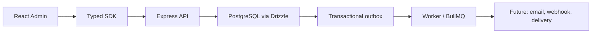
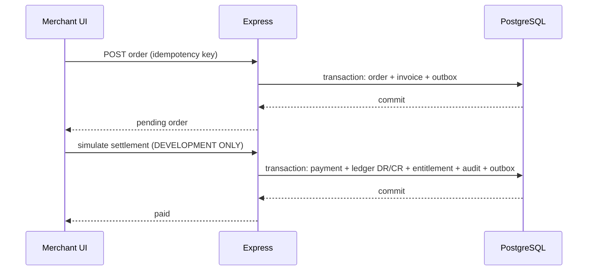

# Architecture and design decisions

## Design goals
Multi-tenant internal billing and digital-product distribution platform. PostgreSQL is the system of record. Drizzle ORM (open-source) is used instead of Prisma. Express exposes a tenant-scoped JSON API, with Zod input validation. A React admin interacts through the `@cpg/kubera` SDK. BullMQ and Valkey handle background processing of outbox events.

## Data flow

## Order state

## Tenant isolation
Each tenant-owned row contains `tenant_id`; routes always filter by it. Tenant-scoped application filters alone are **not sufficient** for security certification. Add PostgreSQL RLS and actor-level access checks as noted in gaps.

## Financial representation
Values use integer minor currency units. A settlement event creates two equal entries (debit `cash_clearing`, credit `merchant_payable`). This is a tiny illustrative posting model, not a complete chart of accounts, refunds, payout, tax, FX, revenue recognition, or reconciliation system.

## APIs and security
The API currently authenticates via a development administrator key for bootstrap and tenant routes. In production use OIDC/JWT, BFF or secure HTTP-only cookie session, per-tenant RBAC, non-browser machine API keys, ingress TLS, KMS-backed secrets, and audit immutable retention. The UI current dev key is intentionally unsafe for public hosting.

## Alternatives evaluated
- PostgreSQL + Drizzle: selected for relational integrity and explicit SQL migrations.
- PostgreSQL + Kysely: excellent fully open-source alternative, typed SQL query builder rather than ORM.
- PostgreSQL + TypeORM: mature but broader abstractions and runtime decoration complexity.
- MongoDB: not preferred for the primary financial ledger.
