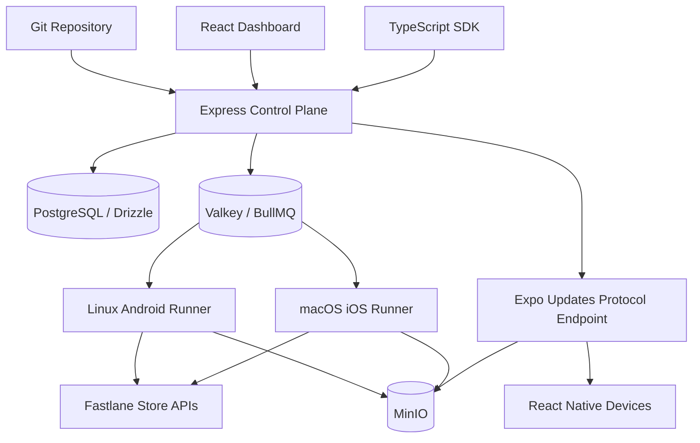

# High-level design

Isolation boundaries: organization-scoped records and API keys, per-job ephemeral workspaces, separate Linux/macOS runners, private credentials, content-addressed immutable artifacts. Public OTA endpoint must authenticate assets and sign protocol responses before production use.
