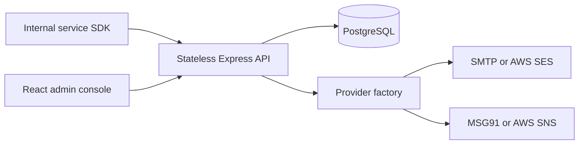

# High-Level Design

Control plane: service registration, provider configurations, templates. Data plane: send request, tenant-scoped template lookup, provider selection, render, provider submission, persist result. PostgreSQL holds durable state; Express has no sticky-session requirements. Provider selection is scoped to a service and channel. Provider configuration encrypted using AES-256-GCM. AWS adapters use the standard AWS credential chain on the server; no AWS access keys are persisted in provider config.

Current send is synchronous and marks `sent` after provider acceptance, **not handset/inbox delivery**. For robust production workloads introduce a durable outbox, queue workers, retries, callbacks and delivery receipts (see gaps).
