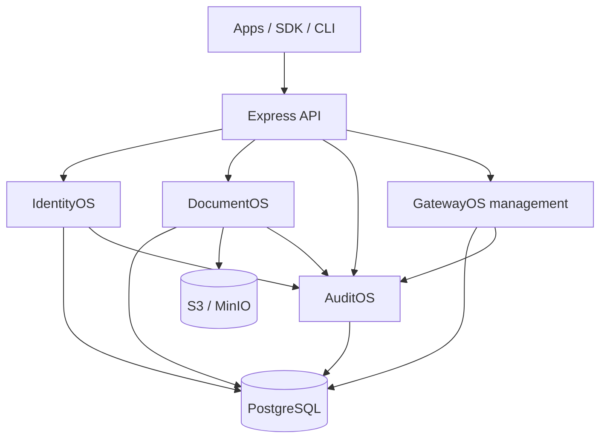

# High-level design

## Boundaries
IdentityOS is the source of identity and session truth; DocumentOS owns file metadata, access and lifecycle; AuditOS owns immutable business event records; GatewayOS owns API key and route configuration. Shared PostgreSQL is an initial deployment choice, not an excuse for cross-module table writes. SDK is a thin typed HTTP client. API routes are versioned `/v1/`.

## Deployment direction
Start as a modular monolith with explicit module boundaries, then separate independent workers and gateway data plane when scale requires. Use managed Postgres, S3-compatible encrypted buckets, a dedicated ingress, secrets manager, telemetry pipeline and CI/CD. Never route untrusted user-provided upstream URLs directly.

## Trust boundaries
All requests require tenant-bound principal except login/bootstrap/health. Signed S3 URLs delegate time-limited access. Auditing should be transactional with business writes via outbox in future; current direct calls are not atomic with originating mutation.
