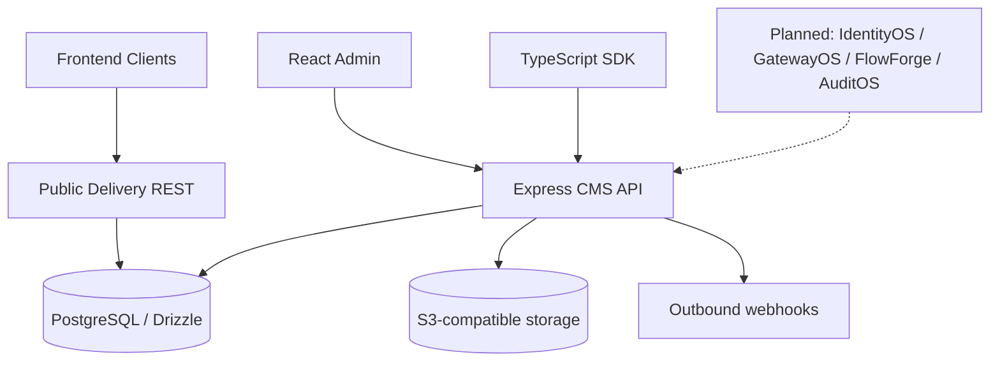

# High-level design

## Boundaries
`apps/admin`: authoring interface. `apps/api`: authentication, content model validation, content state transitions, revisions, locale registry, media presigning, webhooks and audit. `packages/sdk`: typed HTTP client.

## Storage
Content model definitions are stored as JSONB metadata; entries store JSONB document payloads. This avoids runtime DDL for each content model but sacrifices SQL-level field constraints and specialized indexing. Revision snapshots are immutable records in a separate table. Assets store object keys, not binary files.

## Security posture
Public delivery endpoint returns published content only. Admin routes require JWT; writes require editor/admin, model and webhook administration requires admin. **No per-project/tenant scoping, per-model policy, or production token lifecycle yet.** Use behind an authenticated private gateway for evaluation only.

## Scale-out evolution
Move webhook execution to a durable queue, add Valkey caching and invalidation, background publishing scheduler, object upload verification, OpenSearch adapter, read replicas, partitioned audit log, and tenant-scoped credentials.
