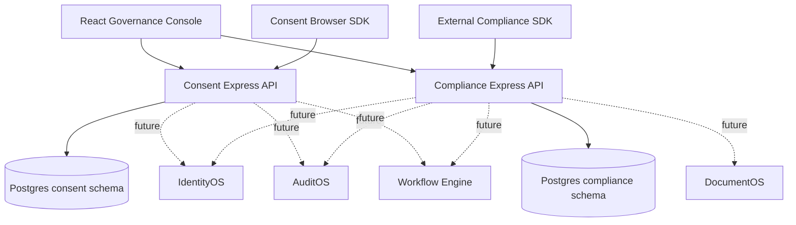

# High-Level Design

## Boundaries
Each service owns its schema. No cross-service direct table access. Future integration via versioned API contracts, outbox and asynchronous events. A single console can deploy independently of either API.

## Availability & scalability
Use stateless APIs, horizontal pod autoscaling, bounded queues and backpressure, connection pooling, regional data residency and backups. None of these are configured for production in the current repo.

## Trust boundaries
Public browser SDK endpoints must not accept arbitrary tenant headers. Domain verification, API key scoping, signed configuration, replay resistance and rate limiting are required. IdentityOS authentication is a mandatory production dependency.
