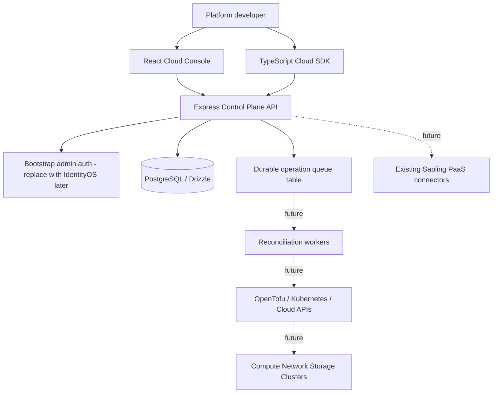

# High-Level Design

All A–L domains are represented as catalog entries and resource kinds. A single generic resource request model is intentionally a bootstrap scaffold; production domain APIs require typed specs, validation and reconcilers. No existing PaaS code is copied.

Trust boundaries: console is untrusted, bearer token required for /v1, PostgreSQL is the control-plane state store. Current tenant headers are **not trustworthy authorization** and must be replaced before multi-user deployment.
