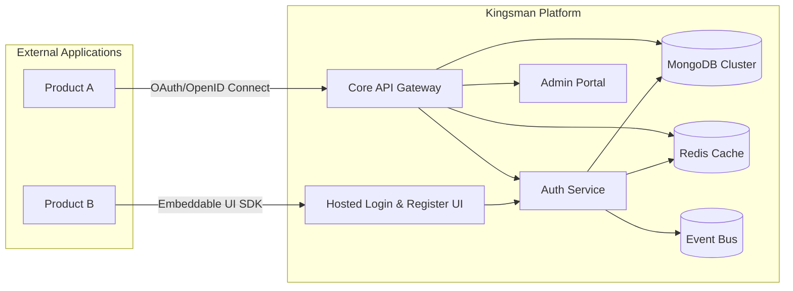
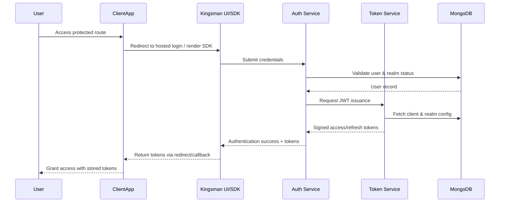

# Kingsman High-Level Design (HLD)

## Overview
Kingsman is a multi-tenant IAM platform built on the MERN stack to deliver centralized authentication, realm isolation, and client integrations. This document captures the macro-architecture, key services, and supporting components required for the v0 launch.

## Architecture Diagrams

### High-Level Context


### Deployment View (MERN Stack)
```mermaid
flowchart TB
    subgraph Client Tier
        AdminSPA[Admin SPA (React)]
        HostedUI[Hosted Auth UI (React)]
        SDK[Embeddable Auth SDK]
    end

    subgraph Application Tier
        APIGateway[API Gateway (Express/Node)]
        RealmSvc[Realm & Directory Service (Node)]
        AuthSvc[Authentication Service (Node)]
        TokenSvc[Token & JWKS Service (Node)]
    end

    subgraph Data Tier
        Mongo[(MongoDB Atlas Cluster)]
        Redis[(Redis Cache)]
        Storage[(Object Storage for assets)]
    end

    subgraph DevOps & Observability
        CI[CI/CD Pipeline]
        Monitor[Monitoring & Alerting]
        Logs[Centralized Logging]
    end

    AdminSPA --> APIGateway
    HostedUI --> AuthSvc
    SDK --> APIGateway
    APIGateway --> RealmSvc
    APIGateway --> AuthSvc
    APIGateway --> TokenSvc
    RealmSvc --> Mongo
    AuthSvc --> Mongo
    TokenSvc --> Redis
    TokenSvc --> Mongo
    APIGateway --> Redis
    CI --> APIGateway
    CI --> RealmSvc
    CI --> AuthSvc
    CI --> TokenSvc
    Monitor --> APIGateway
    Monitor --> AuthSvc
    Logs --> APIGateway
    Logs --> AuthSvc
```

### Authentication Flow Sequence


## Core Modules
- **API Gateway**: Express server handling REST endpoints, authentication routes, client management, rate limiting, and request validation. Integrates with realm-aware middleware.
- **Realm & Directory Service**: CRUD logic for realms, users, groups, and administrative policies. Manages invitations, password hashing, and audit logging hooks.
- **Authentication Service**: Orchestrates login, registration, password reset, and session handling. Interfaces with Token Service for JWT issuance and with the SDK/hosted UI.
- **Token & JWKS Service**: Manages realm-scoped signing keys, issues access/refresh tokens, exposes JWKS, and handles introspection/refresh workflows.
- **Admin SPA**: React-based dashboard for realm administrators to configure settings, manage users, groups, clients, and monitor events.
- **Hosted Auth UI & SDK**: React components providing customizable login/register experiences; SDK wraps token storage and callbacks for integrating apps.

## Data Management
- **MongoDB Schema Highlights**
  - `realms`: metadata, settings, branding, policy configuration.
  - `users`: realm-scoped user documents with credential hashes, profile attributes, statuses.
  - `groups`: realm-scoped group membership relationships.
  - `clients`: client credentials, redirect URIs, scopes, grant types.
  - `audit_events`: append-only log for admin and authentication events.
- **Redis Cache** for session tokens, rate limiting counters, and JWKS caching to reduce DB load.
- **Object Storage** for branding assets (logos) and email templates.

## Integrations
- **Email Service**: Transactional emails for invites, verification, password reset.
- **Monitoring Stack**: Metrics via Prometheus-compatible agent, dashboards in Grafana.
- **CI/CD**: Automated tests, linting, and deploy pipelines per service with environment promotion gates.

## Security Posture
- Centralized secrets via environment vault (e.g., HashiCorp Vault/Azure Key Vault).
- Asymmetric keys per realm stored with rotation metadata.
- Web Application Firewall (WAF) in front of API Gateway; JWT audience/issuer validation enforced by client SDK.

## Technology Stack
- **MongoDB**: Primary datastore for realms, users, clients, and audit events with multi-tenant sharding strategy considered for scale.
- **Express.js**: Service layer foundation for API Gateway, Realm Service, Auth Service, and Token Service.
- **React**: Shared component library powering Admin portal, hosted auth UI, and embeddable SDK components.
- **Node.js**: Runtime for all backend services, enabling TypeScript-based shared models and utilities.
- **Complementary Tooling**: TypeScript, Mongoose ODM, Redis client, JWT libraries, Webpack/Vite for React builds, Docker for containerization.
